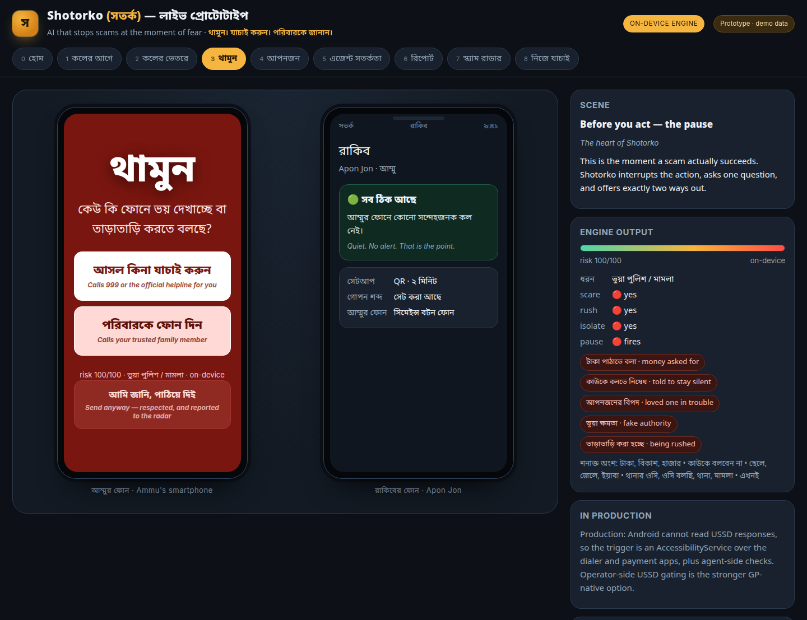
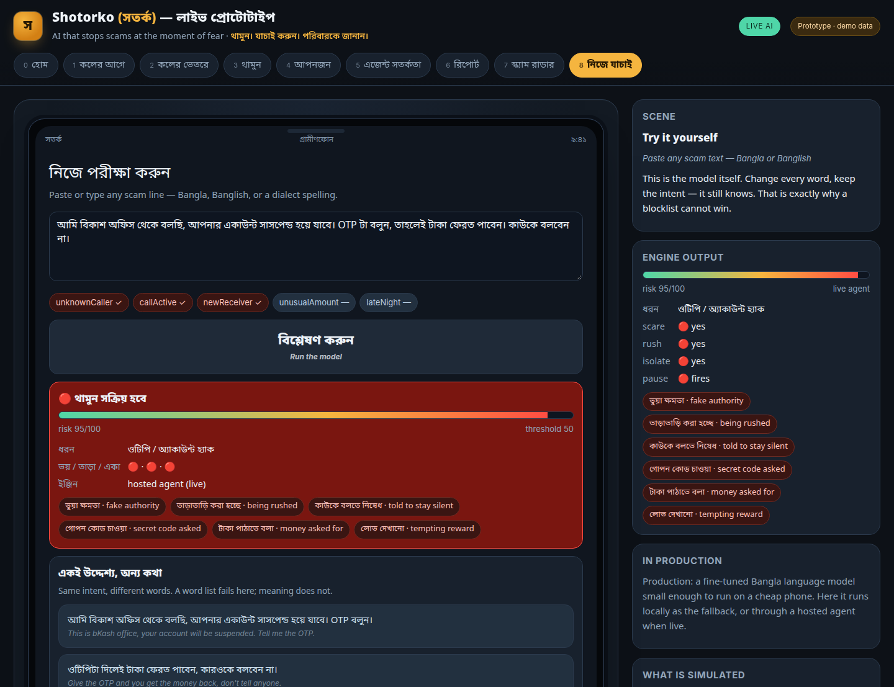

# Shotorko (সতর্ক) — GP FutureMakers 2026 Concept Pitch
## Deck copy, 10 slides, with speaker notes

**Rule for the whole deck:** every number that is demo data is labelled demo data. Judges trust a
team that labels its own fixtures, and a concept pitch is scored on judgement, not on claims.

**Prototype link for slide 10:** `https://abukawser.xyz`
Make it a QR. It works on a phone, needs no login and no install.
**Ready image:** `pitch/qr-abukawser.png` — 900×900, error correction H, decodes to exactly that
address (checked with `zbarimg`). Drop it in at roughly 40 mm square and it scans from a printed A4.
If the venue network cannot resolve the domain, type `https://shotorko-ai.vercel.app` — the same
deployment on its host address, classifier included.
Last resort, no network at all: `https://shotorko-demo-8604o4z09al.qoder.website` — same prototype,
on-device engine only, no hosted classifier.

**Criterion map** (each slide is doing a job):
1 Clarity · 2–3 Depth of Problem · 4–6 Solution Strength, Differentiation, AI Rationale · 7–8 Feasibility & Scalability, Impact · 9 The ask · 10 Close + live proof. Q&A handling is the bank at the end.

---

## Slide 1 — Title

**On slide**

> # Shotorko · সতর্ক
> **The 90 seconds when a phone scam is actually winnable.**
> AI that warns a grandmother in Bangla, on any phone — before she sends the money.
>
> [Name] · GP FutureMakers 2026 Concept Round · Prototype inside

**Speaker note (15s)**
"Shotorko means *be alert*. One sentence: a scam only works for about ninety seconds, and Shotorko is built to win those ninety seconds on the cheapest phone in Bangladesh. There's a working prototype at the end — I'll show you the link."

---

## Slide 2 — The problem is not ignorance. It is timing.

**On slide**

> **The script is always the same.**
> "আমি থানার ওসি" — your son was caught with yaba. Pay 30,000 taka now. Don't tell anyone.
>
> **Why it works**
> - Fear arrives before verification is possible
> - The victim is told to stay silent, so no one can correct them
> - Money moves through an agent shop or USSD in under five minutes
> - By the time they tell the family, the number is dead
>
> **Who absorbs it:** people with the least practice judging a call — older parents in
> district towns, semi-literate users, and anyone whose Bangla is a dialect no product was built for.

**Speaker note (35s)**
"Everyone knows these calls happen. What gets missed is the mechanism. The scam is not a knowledge problem — the victim is not stupid. It is a timing problem. Fear, urgency and a demand for secrecy arrive together, and that combination shuts down the part of the brain that checks. Our design starts from one question: where in that ninety-second window can a network actually intervene?"

---

## Slide 3 — Why the defences today lose

**On slide**

> | What exists | Why it fails here |
> |---|---|
> | Carrier spam filters | Built for nuisance volume, not for a single persuasive human voice |
> | Number blocklists | One new SIM costs ৳200; the script survives, the number doesn't |
> | Bank / MFS fraud rules | They see the transfer, never the call that caused it |
> | Awareness campaigns | They teach a list of phrases; scammers reword faster than campaigns print |
> | Smartphone security apps | Useless on the Tk 800 button phone that is most at risk |
>
> **The gap:** nobody intervenes **between** the call and the money, in Bangla, on the phone the victim actually owns.

**Speaker note (30s)**
"Each of these is a real control and each has a reason it doesn't reach this case. The important one: the bank sees a transaction, the operator sees a call, and no one sees the moment where a person is being frightened into pressing buttons. That moment is the product. Also note the last row — the handset most exposed to this is the one no app can protect."

---

## Slide 4 — What Shotorko does

**On slide**

> **Four moments, one continuous defence.**
>
> **১. Before the call** — one Bangla sentence plays in the network, *before the phone rings*. No app, no install, works on a button phone.
> **২. During the call** — on-device listening understands intent. Nothing is recorded, nothing leaves the handset.
> **৩. থামুন — the pause** — at the moment money or an OTP is about to move, one question appears, with exactly two buttons.
> **৪. After** — the victim speaks what happened in Bangla; Shotorko writes a complaint that can actually be filed, and the report joins a Scam Radar that clusters numbers into networks.
>
> Plus two layers around the person: **আপনজন** — a family alert set up in two minutes by QR — and the **agent shop**, where the shopkeeper gets a warning and one question to ask.

**Speaker note (40s)**
"That's the whole product. The pre-call and network pieces are Grameenphone-native, which is why this belongs to an operator rather than to an app company. The pause is the heart, and I'll show it live in a moment. The after-piece matters for a different reason: today a victim's story never becomes a usable police or fraud-cell record, so the network never learns. Shotorko turns one spoken sentence into three filings."

---

## Slide 5 — থামুন: the pause, live

**On slide**

> ## থামুন
> **কেউ কি ফোনে ভয় দেখাচ্ছে বা তাড়াতাড়ি করতে বলছে?**
> *Is someone on the phone scaring you or rushing you?*
>
> **[ আসল কিনা যাচাই করুন ]** — calls 999 or the official helpline
> **[ পরিবারকে ফোন দিন ]** — calls the trusted family member
>
> *আমি জানি, পাঠিয়ে দিন — respected, and reported to the radar*
>
> **Shotorko never blocks. The user always keeps the last button.**
> 

**Speaker note (45s)**
"This is the screen. Notice what it does *not* do. It does not block the call. It does not say 'you are being scammed' — we may be wrong, and when we're wrong we must not have cost someone a real transaction. It asks one question that a frightened person can answer honestly, and gives two exits, both of which are a phone call to a human. And there is a third button: 'I know, send it anyway' — which is honoured, and which teaches the model. On a feature phone the same pause is a voice prompt with two keys."

---

## Slide 6 — The AI: intent, not a word list

**On slide**

> **A blocklist cannot win.** Scammers reword; a blocklist chases.
>
> The model reads **eight signals** and **the situation around them**:
> `authority · leverage · urgency · secrecy · credential · payment · reward · install`
> × `unknown caller · call in progress · first-time receiver · unusual amount · late night`
>
> **The same words, different risk**
> | "টাকাটা পাঠিয়ে দিও" from a saved contact at noon | quiet |
> | "টাকাটা পাঠিয়ে দিও, কাউকে বলো না" from a new number mid-call | **pause** |
>
> **Decided on-device, in Bangla, Banglish and dialect spelling.**
> Small enough to run on a cheap Android handset. No audio stored, no audio uploaded.
> A hosted model handles only the generative part — turning a spoken story into a written complaint.
>
> **Prototype evidence:** 69 backend checks pass offline · 5 reworded scam families all classified · 10 benign sentences, **0 false pauses** in friendly context and 1 with every hostile flag forced on · threshold 50/100, and the pause additionally requires consent *and* an actual ask.
> 

**Speaker note (45s)**
"The technical claim I want you to test is this: the classifier does not look for the word 'OTP'. It looks for pressure — someone claiming authority, someone mentioning your child, someone rushing you, someone telling you to stay quiet, and then someone asking for money or a code. Any one of those is normal conversation. The combination is the signature, and rewording doesn't escape it because the signals are semantic. The reason it has to be on-device is not privacy alone — it's that a rural handset on 2G cannot round-trip to a cloud model inside the pause window. The prototype on the last slide runs this real classifier in your browser."

---

## Slide 7 — Why Grameenphone can build what an app company cannot

**On slide**

> **The moat is the network.**
>
> | Capability | Where it lives |
> |---|---|
> | Play a Bangla warning **before the ring** | Network announcement injection — no handset permission needed |
> | Warn on a **Tk 800 button phone** | Happens in the network, so the device is irrelevant |
> | Caller reputation at launch | GP's own call records: new SIM, fan-out pattern, report history |
> | Stop the *forwarding* scam | USSD gating on `*21` — GP-side, not app-side |
> | The agent-shop checkpoint | Inside the MFS agent app GP already operates |
> | Close the loop | GP fraud cell already receives these complaints |
>
> **Honest engineering constraints we designed around:**
> Android cannot read USSD responses, so the on-device trigger is an AccessibilityService over the
> dialer and payment apps — or, stronger, operator-side gating. Live-call Bangla recognition on the
> handset is the hardest single piece in the plan and is where we'd start the R&D clock.

**Speaker note (35s)**
"An app company can only protect the smartphone it was told to protect. Grameenphone sits where the call, the SIM, the USSD session and the agent network all already are. That's why the same product reaches a feature phone and a smartphone without asking anyone to install anything. We've also listed what we can't do — because the honest version of this plan is stronger, and the constraints are all solvable inside the operator."

---

## Slide 8 — Impact, and how it scales

**On slide**

> **Direct impact**
> - Money saved stays with the person least able to lose it — a 30,000 taka loss is a year, not a number
> - Every intervened call becomes a structured report instead of a family argument
> - Trust in digital finance rises, which is GP's own MFS float
>
> **Prototype dashboard (DEMO DATA — simulated, not a field trial)**
> 10,000 protected users · 1,284 scam attempts · 796 stopped · **62% interruption rate**
> 412 pauses fired · 168 family alerts · 97 agent-shop warnings · **41s average pause**
> 31 false alarms, counted on purpose — "ঠিক ছিল" feedback on every warning
>
> **Scale path**
> 1. GP-only pilot: reputation + pre-call announcement + radar, one division, 90 days
> 2. Android app for the on-device pause where handsets allow it
> 3. Any operator via a shared report format — the fraud scripts are national, not per-network
> 4. Public channel: police 999 and BTRC get the clustered network view, not raw complaints

**Speaker note (35s)**
"I want to be precise about that dashboard: it's the prototype's own demo data, not results from users. The number I'd defend is the 41-second average pause — because that's not a revenue metric, it's the measurement of whether we interrupted the fear long enough for a second human to enter the conversation. And false alarms are counted deliberately. A safety product that doesn't measure its own wrongness will be switched off within a month."

---

## Slide 9 — What we need, and the first 90 days

**On slide**

> **Weeks 1–4 — prove the classifier on real language**
> Collect 2,000 real scam call recordings with consent from GP's fraud cell + police complaints.
> Fine-tune the small Bangla intent model. Publish a false-positive rate, not just a recall.
>
> **Weeks 5–8 — network slice, one district**
> Caller reputation + pre-call Bangla announcement + a 999 helpline handoff. Feature-phone path only,
> so the pilot reaches the actual at-risk group. Target: 5,000 users, opt-in.
>
> **Weeks 9–12 — measure, then decide**
> Interruption rate, money preserved, false-alarm rate, complaint-to-filing conversion.
>
> **What we're asking GP for**
> 1. Access to anonymised fraud-call CDR patterns and complaint text for training
> 2. A network-side announcement test slot and one USSD gating experiment
> 3. Introductions to the GP fraud cell and one MFS agent-network region
> 4. A pilot district and 90 days

**Speaker note (25s)**
"This is deliberately narrow. The first four weeks are not building a product, they're getting permission to be honest about the model — we cannot claim a Bangla scam classifier without real Bangla scam speech, and that data sits in GP's fraud cell. If the classifier's false-positive rate is bad after week four, the right decision is to ship the pre-call warning and the radar alone, which still need no handset at all."

---

## Slide 10 — Try it on your phone

**On slide**

> ## সতর্ক থাকুন। পরিবারকে জানান।
> *Stay alert. Tell the family.*
>
> **Live prototype — no login, no install, works on a phone**
> **QR →** `https://abukawser.xyz`
> 
>
> Nine screens, the whole journey: pre-call warning, live call listening, the থামুন pause,
> the family circle, the agent checkpoint, spoken report → filed complaint, and the Scam Radar.
>
> On the site, press **"▶ Play the story"** — it runs the whole journey in under a minute.
> Then open **"নিজে যাচাই"** and type any scam line you've ever received, in Bangla or in
> Banglish. Two classifiers answer: the **on-device** one, which needs no network at all
> and is what ships first, and — flip **"Live agent"** — a hosted one making a real model call.

**Speaker note (25s)**
"Everything you saw on the pause screen is running in that page. The on-device engine answers with no network whatsoever, and that is the version phase one ships. Flip the **Live agent** switch and the same screen makes a real hosted model call instead: on the থামুন transcript it came back risk 95, five intent signals, ভুয়া পুলিশ, and it paused; on family talk and a recharge SMS it came back zero and stayed quiet. The number reputations and the radar are demo data, and the page says so on every screen. Nothing in the classifier is a mock — type into it. Thank you."

---
---

# Q&A bank

*Seven scored criteria; six of them are won or lost here. Answer in this order: the direct answer, then the honest limit, then what would change the answer.*

### On the AI

**1. Why on-device at all? Just run a big model in the cloud.**
"Because of the pause window. We have seconds while a person is mid-conversation, on a rural handset that may be on 2G. A round trip is not the failure — the failure is the round trip failing silently and the user never hearing anything. On-device also solves the privacy objection permanently: there is no audio upload to secure. The cloud is used for the part that genuinely needs generation — turning a spoken story into a written complaint — where a few seconds is acceptable."

**2. How do you stop false positives? Warning someone during their son's real call to ask for money is a disaster.**
"Three gates. First, the pause needs an actual ask — payment, a code, an install, or call forwarding. Words alone don't fire it. Second, the situation multiplies the score: a saved caller, daytime, familiar amount stays quiet. Third, the threshold is deliberately conservative, and the product is allowed to be wrong quietly — it warns, it never blocks, so a false positive costs one screen, not a broken transaction.

I measured it rather than hoping: ten ordinary sentences — a son home from school, a class fee, borrowing from a brother, a delivery, a recharge SMS, a doctor's bill, a wedding, a neighbour's advance, a Banglish rickshaw fare, and a child asking her mother not to tell her father — run through the classifier twice, once with friendly context and once with every hostile flag forced on. Friendly context: **zero pauses out of ten**, the worst one scoring 32 against a threshold of 50. Every hostile flag on: **one pause in ten**, and it was the last sentence — 'tell abbu nothing, I need 3000 taka' — which under 'unknown caller, mid-call, unusual amount, 2am' is the definition of the attack, so I count it as correct behaviour with a false alarm attached. The five scam scripts as controls paused four. The fifth was a bare `*21` instruction with no money, no code and no pressure: it stayed quiet on purpose, because the pause is not how we stop forwarding — that's the network-side gating on slide 7. And we ship a 'ঠিক ছিল' button on every warning so the false-alarm count is a live number, not a hope."

**3. Your 'model' in the prototype is a scoring function, not a neural network. Isn't that overclaiming?**
"The prototype's default engine is a deterministic implementation of the signal model — on purpose, because it's the part that must be inspectable and it runs instantly offline. The same page can flip to a hosted classifier over the identical output contract, and that's the point: the schema, the gates and the labels are the design work, and any model that fills that contract drops in without touching the product. What I'd need is the training corpus, which is exactly item one on the ask slide."

**3b. You flipped it to 'Live agent' — so is the pause a cloud call after all?**
"Only as a demonstration of the contract. The hosted call returns risk, signal keys and a pause flag; the page never renders a string from the model, every label is fixed server-side, and the pause still needs the server's own ask-gate before it interrupts. Two properties we'd keep either way: if the network is slow, blocked or rate-limited, the page falls back to the on-device verdict with no visible failure, because a safety product that depends on connectivity is worse than none; and the classifier's answer is never allowed to decide the interruption alone."

**4. Bangla dialects, Chittagonian, Sylheti, and Banglish typing. How does that work?**
"Two things. The prototype already normalises Banglish — Latin-typed Bangla — and dialect spellings, because that's how people actually write, and it's cheap to handle with stems. For speech, dialect is the hardest item in the plan and I won't pretend otherwise; that's why the first milestone is real recordings, and why the network-side pre-call warning works with no speech recognition at all. We do not need the model to be perfect for the first layer to save money."

**5. What does the model see — the whole call?**
"No. It sees the current utterance and the rolling signal set, and nothing is stored. There is no recording, no upload, and no call history. If a user has not opted in to during-call listening, the product still has the pre-call warning and the radar, which need no audio at all."

### On feasibility

**6. Can you really inject an announcement before the ring?**
"That's a network capability GP has, not something we'd have to invent — it's the same class of mechanism as operator voice prompts and ringback content. It's item two on the ask slide precisely because it needs a test slot, not because it's theoretically impossible. And the fallback is honest: if injection can't be reached, the same warning plays as a USSD or SMS flash at call setup, which is weaker but still network-side and still reaches a button phone."

**7. Android can't read USSD responses. So how does the pause fire when someone is doing `*247#`?**
"It can't, which is why we don't claim it. Two real options: an AccessibilityService watching the dialer and payment apps, which works but is a permission we'd have to earn carefully; or operator-side gating on the forwarding and cash-out codes, which is the stronger design and only an operator can do. The prototype's pause fires on the intent — the request for money or a code — not on a fake claim of reading the screen."

**8. What's the cost per user? Does this need a data centre?**
"The pre-call warning and the radar are network-side and cheap: a lookup at call setup and a nightly clustering job over complaints. The on-device model costs GP nothing in inference because the handset pays for it. The cloud is for generation only, and it is user-initiated — a hosted classifier or a written complaint. On the prototype today that round trip is about a second and a half end to end, and nothing in the pause path waits for it, because the interruption decision is made locally first and independently."

**9. What breaks first at 100,000 users?**
"Number reputation staleness and report quality. A blocklist decays in days. The radar is the answer — clustering by script rather than by number means a fresh SIM inherits the network's history the moment it repeats the phrasing. The second thing that breaks is trust: at scale, a few loud false positives will end the product, which is why the false-alarm count is a first-class metric on the dashboard from day one."

### On differentiation and the business

**10. Why won't Telenor or Robi just copy this in six months?**
"They can, and eventually one will. The durable advantage isn't the algorithm — it's being the operator whose users learned that their network warned them, and having the largest report corpus in the country feeding the clustering. That's also why we'd push the report format as a cross-operator and police standard early: as the originator, GP's data is in every cluster; as a follower, it isn't."

**11. Isn't this a feature, not a product?**
"As a single screen, yes. As a loop — warn, pause, notify family, checkpoint at the agent, convert the story into a filing, and cluster filings back into reputation — it's a product with its own retention reason and its own data asset. The evidence it's not a feature is that half the loop needs no handset software at all."

**12. Who pays? What's the revenue?**
"GP pays, and the justification is not ARPU — it's float trust and support cost. Every fraud loss on bKash is a customer who stops trusting digital finance, plus a call-centre case, plus a regulatory story. The secondary path is the one every operator eventually sells: verified fraud intelligence to banks, MFS providers and police. I'd be careful about charging the victim for their own protection."

**13. Google and Samsung already have scam detection. Why does Bangladesh need another one?**
"They need a smartphone, English-first or a limited language list, and handset-level permissions, and they block rather than intervene. The at-risk person here is on a Tk 800 button phone in a district town speaking Sylheti. Anything that requires them to own the right handset has already excluded them."

### On impact and ethics

**14. What about surveillance? A service that listens to calls is exactly what people fear about operators.**
"The design answer is that the sensitive part never leaves the handset and nothing is stored — that's why on-device is a product decision, not a technical preference. The parts that are network-side use call metadata, not content. And the family alert sends 'a suspicious call is running', never what was said. If we can't state that in one sentence a user believes, we shouldn't ship it."

**15. What if a scammer uses Shotorko — say, to find out whether a number is protected?**
"The radar only ever answers about a caller, not about the listener, and the reputation answer is a warning string, not a user record. Nothing in the product tells a caller whether the person they're ringing has protection on. The abuse surface I'd worry about more is false reports poisoning a number's reputation, which is why reports are clustered and a single complaint never silently blocks anything — the product doesn't block at all."

**16. What would make you stop working on this?**
"If after four weeks of real recordings the false-positive rate can't be pushed low enough that a warning is worth less than the annoyance it causes. In that case the pre-call warning and the radar still stand on their own, and the pause gets dropped. I'd rather name that now than be asked for it."

---

# Layout notes for whoever builds the slides

- **A rendered preview of this copy exists:** open `pitch/deck.html` (arrow keys, `N` for notes,
  Ctrl-P prints exactly 10 landscape pages). Regenerate it after any edit with `node dev/build-deck.mjs`.
  It reads this file — the copy and the preview cannot disagree. It also flags any slide whose text
  runs past one 16:9 frame at projector size, which is the cut list for the day.

- **The .pptx is generated, not hand-built:** `python3 dev/build-pptx.py` writes
  `pitch/Shotorko-GP-FutureMakers-2026.pptx` from this file — the speaker notes are read from here, so
  the deck and these notes cannot disagree. Edit `dev/build-pptx.py`, never the .pptx.
- **Nothing on this machine can open PowerPoint**, so `python3 dev/render-pptx.py` re-draws the real
  .pptx with PIL at 128 px/inch into `.deckcheck/` and reports off-slide shapes, text that will not fit
  its box, unbreakable words and colliding copy. Read the ten PNGs before believing any claim about how
  a slide looks. A clean report is not proof the deck is finished; a dirty one is proof it isn't.
- **Slide 5 is the money slide.** `dev/shots/devices/thamun.png` full-height. Bangla headline stays at
  least 58pt — it has to be read on a projector from the back.
- **The 46-second clip is deliberately NOT embedded** (`dev/clip/shotorko-story.mp4`). There is no
  renderer here to prove a media part opens clean, and a "repair this deck" prompt on the graded upload
  is the one failure that cannot be recovered from. Carry the clip as a file on the laptop instead: if
  the venue network dies, play it and keep talking. A clip of the real product beats an apology for a router.
- **Which images the slides use:** everything in `dev/shots/devices/` is a 2× crop of the single handset
  element on the live page — a whole dashboard shrunk into a PowerPoint is unreadable, a phone is not.
  `dev/shots/*.png` are the full pages, kept for reference. `verdict.png` is the console's verdict card
  alone, and it is the only slide image produced by a real hosted model call. Re-shoot all of it with
  `node dev/shoot.mjs https://abukawser.xyz` after any UI change.
- **Slide 6**: the eight signals are chips, not a bullet list, and `devices/verdict.png` sits beside them
  so the "type anything" claim is visibly a real answer, not a mock.
- **Slide 7's table** is the differentiator for a GP audience — give it room, don't shrink it.
- **Slide 8**: the words "DEMO DATA" must be visible on the slide itself, not only in the notes.
- **Slide 10**: QR must be at least 8cm on the projected slide and printed large enough to scan from a
  seat. Test it from 2 metres with your own phone before the day. The slide says *on the site, press
  ▶ Play the story* — the button is on `abukawser.xyz`, not in the .pptx.
- Bangla is a complex script: PowerPoint reads the face from `a:cs`, and `font.name` only ever writes
  `a:latin`. `set_fonts()` in the builder writes all three channels, and any run mixing Bangla into an
  English sentence is split into separate runs so the Latin keeps Segoe UI.
- Palette already used by the prototype, keep the deck consistent: background `#0d1117`, amber `#f5b53f` (Shotorko's voice), calm green `#4fd6a8`, red `#ff4d43` reserved **only** for থামুন.
- Type: Noto Sans Bengali / Hind Siluri for Bangla, a clean grotesque for Latin.

# Pre-flight — run these before the deck is uploaded, and again on the morning

Everything above is a claim until these four commands say otherwise. They need no key and no
browser, and they take about five minutes.

| | Command | What it proves |
|---|---|---|
| 1 | `node dev/backend-check.mjs` | The classifier's contract: server-owned labels, the ask-gate, no credential or provider text ever reaching the browser. 69 checks, all offline. |
| 2 | `node dev/false-positive-battery.mjs local` | The false-alarm numbers in Q&A 2, against the on-device engine. Deterministic, no quota, re-runnable anywhere. |
| 3 | `node dev/false-positive-battery.mjs https://abukawser.xyz` | The same battery against the hosted model. **This one depends on Google's free quota, which is measured per day** — run it early in the day, not at 4pm. |
| 4 | `node dev/live-probe.mjs` | A real browser opens the deployed page, flips to Live agent, reads the rendered Bangla labels and files a complaint. The only check that proves the demo a judge sees. |

Then by hand, on a phone, on the venue network rather than the office one:

- Scan the QR on `pitch/qr-abukawser.png` and press **Play the story** once, end to end.
- Type one scam line you actually received into **নিজে যাচাই**, in Bangla or Banglish.
- Flip **Live agent** and run the same line. If it comes back on-device with no visible error, that
  is the fallback working, not a failure — say so out loud, it is a better answer than a green tick.

**If the hosted engine is throttled on the day:** nothing about the pitch changes. The on-device
engine is the version phase one ships, it answers with no network at all, and Q&A 3b already says
the cloud call is a demonstration of the contract. Lead with the offline engine, flip to live if it
answers, and never let a demo depend on a quota you don't control.

## Run log — re-run these against the numbers printed on the slides

| 15 Oct | Check | Result |
|---|---|---|
| 1 | `backend-check.mjs` | **69/69 pass**, offline |
| 2 | `false-positive-battery.mjs local` | **0/10 calm · 1/10 hostile · 4/5 scams** — exactly the line on slide 6. Worst calm score 32 against a threshold of 50; the one hostile pause is "tell abbu nothing, I need 3000 taka", which under unknown-caller/mid-call/2am is the attack, so it is correct behaviour with a false alarm attached. The 5th scam stayed quiet on purpose: a bare `*21` with no money, code or pressure is stopped network-side, not by the pause. |
| 3 | `false-positive-battery.mjs https://abukawser.xyz` | **Did not complete — 12 of 25 requests came back HTTP 429 `rate_limited`.** Its `0 paused of 5` footer is a quota artifact and must never be quoted as a hosted result. Re-run after the daily reset. |
| 4 | `live-probe.mjs` | **9 of 10 pass; the 1 failure is the quota, not the product.** The hosted console call came back `HTTP 429` and the page answered on-device anyway — risk 83, pause fired, four server-owned signal keys, chips rendered as labels not objects, and the spoken story became a 1065-character complaint draft. That is Q&A 3b's fallback claim observed in a real browser, which is a better thing to have proven than a green tick. |
| — | `shoot.mjs` | The console verdict on slide 6 **is** a real hosted answer: `engine=live`, risk 95/100 against threshold 50, six intent signals named in Bangla. One observed call, described as one observed call. |

So every number printed on a slide is an **on-device** number, re-measured today. The only hosted
claim on any slide is the single verdict card, and it says "a real hosted model call" rather than
implying a rate.

---

# Timing

Slides 1–4 ≈ 2:00 · slide 5 ≈ 0:45 · slide 6 ≈ 0:45 · slides 7–8 ≈ 1:10 · slides 9–10 ≈ 0:45.
**Total ≈ 5:25.** To cut to 3:00, drop slide 3's table to three rows, merge 7 into 8, and shorten slide 9 to the four asks.
